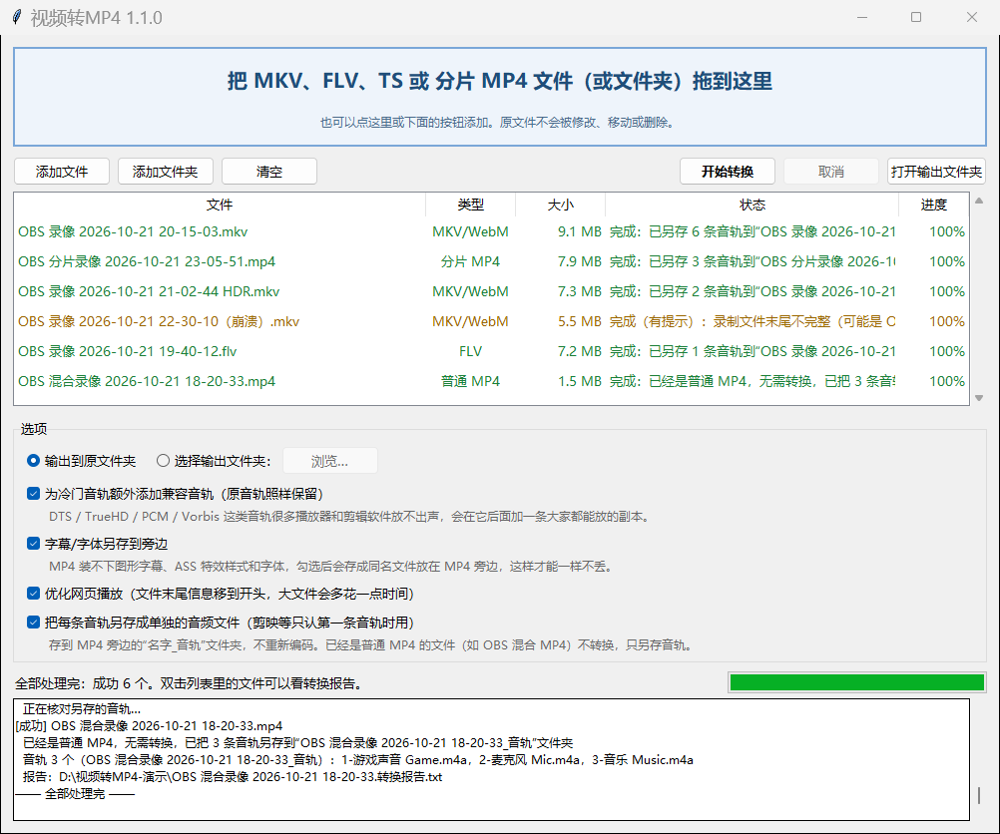

# 视频转MP4

把 OBS 录的 MKV、FLV、TS、分片 MP4/MOV 一键换成普通 MP4：不重新压缩，音轨和信息尽量原样保留（例外见[已知限制](#保留什么已知限制)），转完逐条核对并写一份报告。

[English](#english)



## 它做什么

- **MKV / WebM → MP4**：画面和声音原样复制（只换“外壳”），一般情况下画质、音质和原来完全一样，速度主要看硬盘。
- **FLV / TS / M2TS → MP4**：OBS 也能录成 FLV 或 TS，同样原样复制；TS 里的多条音轨和语言、FLV 里的 HEVC/AV1（增强型 FLV）都保留，音画同步和起始时间按源文件保持（转完会核对）。
- **分片 MP4/MOV → 普通 MP4**：OBS 的 Fragmented MP4/MOV、崩溃后没收尾的混合 MP4、DASH/CMAF 下载的 `.mp4`/`.m4s`，整理成剪辑软件和播放器都认的普通 MP4。
- **原文件不动**：先写成 `xxx.partial.mp4`，全部成功后才改成正式名字；取消或失败只删除没写完的文件；同名文件不覆盖，自动改成 `原名 (1).mp4`。
- **转完就检查**：原样复制的轨道逐包和源文件比对（超大文件抽查每条轨道前 3000 个包），开头、结尾各试解码 20 秒，核对轨道数、语言、默认/强制标记、章节、时长、HDR 信息，结果写进 `原名.转换报告.txt`。
- **批量**：拖进文件或整个文件夹（含子文件夹），也可以把文件直接拖到程序图标上自动开始。

### 对 OBS 用户

- 多音轨全部保留：顺序、你在 OBS“音频”设置里起的音轨名、“只有第 1 条是默认音轨”的标记都保留。
- 录制中断（OBS 闪退、死机、断电）的 MKV、FLV、TS 和分片 MP4：能读到的部分全部转出来，报告里写明转到了几分几秒；分片 MP4、FLV、TS 最后一个只写了一半的帧会去掉，避免结尾花屏或爆音。救回多少主要取决于 FFmpeg 本身的读取能力，本工具负责用中文讲清楚救回了多少。
- 大文件：开始前检查输出盘剩余空间，FAT32 U 盘放不下 4 GB 以上文件会提前提示。
- 报告里只写文件名，不写完整路径，可以放心把报告发给别人帮忙看。
- **剪映等软件只认第一条音轨**：勾选“把每条音轨另存成单独的音频文件”，MP4 旁边会多一个 `名字_音轨` 文件夹，每条音轨一个文件（如 `1-游戏声音.m4a`、`2-麦克风.m4a`，不重新编码，和源文件逐字节核对），拖进剪辑软件和画面开头对齐即可。某条音轨本来就比画面晚或早开始时，报告里会写出差多少秒。
- **OBS 32 默认的混合 MP4**：正常停止的混合 MP4 不需要转换；勾选上面这个选项后，本工具不转换它，只把它的音轨另存出来（这正是剪映只读到第一条音轨时最常见的情况）。

## 下载和使用

1. 到本仓库的 **Releases** 页面下载最新的 `Remux2MP4-v<版本>-win64.zip`。
2. 右键 →“全部解压缩”，双击 `视频转MP4.exe`（第一次运行 Windows 可能提示“已保护你的电脑”，点“更多信息”→“仍要运行”）。
3. 把文件或文件夹拖进窗口，点“开始转换”。转完点“打开输出文件夹”，双击列表里的文件可以看转换报告。

详细说明（旁边多出来的文件是什么、各选项的含义、常见问题）见 [README-使用说明.txt](README-使用说明.txt)，压缩包里也有一份。

命令行（源代码里的 `mkv2mp4.py`）：

```
python mkv2mp4.py 录像.mkv 另一个文件夹 -o 输出文件夹 --recursive
```

其他参数：`--export-audio`（把每条音轨另存成单独的音频文件；已经是普通 MP4 的文件只另存音轨）、`--no-companion`（不加兼容音轨）、`--no-sidecars`（不另存字幕字体）、`--no-faststart`（不把索引移到开头）、`--no-verify`（跳过逐包比对和试解码）。返回码：0 全部成功，1 有失败或被取消，2 没找到可处理的文件，3 找不到 ffmpeg/ffprobe。

程序按这个顺序找 `ffmpeg.exe` / `ffprobe.exe`：程序旁边的 `bin\` 文件夹 → 环境变量 `MKV2MP4_FFMPEG_DIR` 指向的文件夹 → 系统 PATH。都找不到时，图形界面会弹窗、命令行会在错误输出里说明该把它们放在哪里。

## 和 OBS 自带的“重新封装录像”有什么区别

OBS 自带 **文件 → 重新封装录像**（File > Remux Recordings），很多情况下它就够用：

- 它能批量处理、可以拖入文件夹；复制所有流和每条流的元数据（轨道名只写进 MP4 的 `udta/name`，不写 `handler_name`）；HEVC 会标成 `hvc1`；HDR 信息能保留；也能把分片 MP4/MOV 转成普通 MP4；遇到截断的文件会写出能读到的部分（只有部分读取错误会提示“录像封装已转换，但文件可能不完整”）。
- 它**不**复制章节、全局标签和默认/强制标记，会重置音频声道布局；没有转换后检查和报告；不检查剩余空间；目标文件已存在时询问后覆盖；取消或失败会在正式文件名处留下不完整的文件；只要有一条 MP4 装不下的流（ASS/PGS 字幕、字体附件），整个任务就失败；而且需要装着 OBS。

本工具多做的事：章节、全局标签、默认/强制标记照样保留；MP4 装不下的字幕、字体、附件另存到旁边而不是整体失败；每个输出都和源文件逐条核对并写报告；先写临时文件、绝不覆盖、开始前检查空间；不需要安装 OBS。这几点在同类工具里不算独有，但比较少见。

### 什么时候不需要这个工具

- **OBS 32.0 及以上新建的配置文件，默认录像格式就是混合 MP4（Hybrid MP4）**。正常停止录制的混合 MP4 本来就是普通 MP4，不需要转换（拖进来会提示“已经是普通 MP4，无需转换”）。只有崩溃后没收尾的混合 MP4 才需要整理；如果只是剪映等软件只认第一条音轨，可以用上面的“另存音轨”选项。
- 本工具适合：还在录 MKV / FLV / TS / 分片 MP4 的旧配置、崩溃的录像、来自其他软件的 MKV、电脑上没有 OBS 的人，以及需要批量转换并逐个核对的情况。
- **用普通 MP4 格式录制时崩溃、文件里没有 `moov` 索引**的，本工具救不了（会提示并跳过）。可以试试 [untrunc](https://github.com/anthwlock/untrunc)（GPL-2.0），它需要一个用相同设置录制的、完好的参考文件。
- 想剪切片段、手动挑选轨道：[LosslessCut](https://github.com/mifi/lossless-cut) 更合适（它的 README 写着还不支持批量导出，MP4 装不下的轨道需要手动关掉）。
- 想自己配置 ffmpeg 参数做批量转换：[FFmpeg Batch AV Converter](https://github.com/eibols/ffmpeg_batch)（有中文界面，但参数要自己设）。

## 保留什么、已知限制

保留：全部视频、音频、字幕轨道及顺序；轨道名（写成 `handler_name`，基于 FFmpeg 的播放器会显示，其他播放器可能不显示）；语言；默认/强制等标记；章节（含中文标题）；标准全局标签（标题、艺术家、日期、注释等）；封面图；HDR10 / HLG 信息（报告里会写检查结果）。

MP4 装不下、另存到旁边的：

| 文件 | 内容 |
|---|---|
| `原名.3.chi.srt` / `.ass` / `.vtt` | 原来的文字字幕。MP4 里也有一份（`mov_text`），但 ASS 的字体、颜色、位置在 MP4 里会丢，旁边这份是完整的 |
| `原名.4.chi.sup` | 蓝光 PGS 图形字幕（MP4 完全装不下） |
| `原名.5.eng.mks` | 其他图形字幕或特殊字幕的原样副本 |
| `原名.2.eng.mka` / `.mkv` | MP4 装不下的音轨或视频轨的原样副本（MP4 里放的是转换后的版本） |
| `原名_fonts\`、`原名_附件\` | MKV 里附带的字体、封面图等附件 |
| `原名.metadata.txt`、`原名.源文件信息.json` | MP4 存不下的自定义标签、BCP-47 语言代码、原始轨道信息等，留个记录 |

已知限制：

- 极少数 MP4 根本装不下的老格式会**重新压缩**：VP8、Theora、WMV、ProRes、H.263、DivX 3 视频 → H.264（10 位或 HDR 画面 → 10 位 H.265，保留 HDR 标记），原始视频流另存一份 `.mkv`；WavPack、TTA → FLAC（无损）；WMA、Speex 等 → AAC。报告里会写明。OBS 录的视频不会遇到这种情况。
- DTS、TrueHD、PCM、Vorbis 可以放进 MP4，但很多播放器、手机和剪辑软件放不出声。默认会在原音轨后面加一条兼容音轨（DTS/Vorbis → AAC，TrueHD/PCM → FLAC），原音轨照样保留；分片 MP4 只做原样整理，不加兼容音轨。
- `zh-CN`、`pt-BR` 这类 BCP-47 语言代码会换成 MP4 支持的三字母代码，原值记在 `源文件信息.json` 里。
- 杜比视界（Dolby Vision）没有样片实测，会尽量原样复制；检查发现丢了会在报告里提示。
- 崩溃录像最后几秒没写完的数据无法恢复。
- 只用 FFmpeg 验证过能解码；Windows 自带“媒体播放器”、手机、电视能否播放没有逐一实测。Windows 自带播放器和大多数手机、网页一般只播放第一条（默认）音轨；Windows 11 24H2 全新安装可能不带 AC-3/E-AC-3 解码。
- 真实光盘的 PGS/VobSub 字幕、HE-AAC、DTS-HD MA、VC-1 等没有样片实测（测试素材全部是合成的）。
- 拖放只支持 Windows；macOS / Linux 可以直接用源代码（命令行，或没有拖放的图形界面）。
- 程序用 PyInstaller 打包，个别杀毒软件可能误报。程序不联网、不修改系统设置。

兼容性实测记录见 [docs/compat-matrix.md](docs/compat-matrix.md)，同类工具调研见 [docs/research-existing-tools.md](docs/research-existing-tools.md)。

## 从源代码运行和构建

需要 Windows、Python 3.11+（带 Tkinter）、ffmpeg/ffprobe（放法见上文的查找顺序）。

```
python gui.py                      # 图形界面
python mkv2mp4.py 录像.mkv         # 命令行
pip install -r requirements-build.txt
python build.py                    # 生成 dist\视频转MP4\ 和 dist\Remux2MP4-v<版本>-win64.zip
```

图标是仓库里的 `assets/app.ico`。FFmpeg 怎么随程序发布、怎么自己编译，见下面的 FFmpeg 一节。

## 测试

测试素材全部由脚本生成，不提交到仓库。步骤（生成素材、从源代码跑的测试、需要打包好的程序才能跑的测试）见 [tests/README.md](tests/README.md)。

## FFmpeg

发布的压缩包在 `bin\` 文件夹里带了 FFmpeg：本项目自己从 FFmpeg 官方源代码编译的精简版 **FFmpeg 8.1.1**（`ffmpeg.exe`、`ffprobe.exe` 和 7 个 DLL，约 59 MB）。

- **内容**：FFmpeg 源代码没有修改；静态链接了 x264、x265、dav1d 和 zlib；去掉了网络、采集设备、硬件加速和 ffplay。FFmpeg 自带的解码器、封装格式和比特流过滤器全都保留，本工具用到的功能都在里面（测试全部用这个精简版跑）。1.0.0 带的是 gyan.dev 的完整版（455 MB）。
- **许可**：GNU GPL 第 2 版或更新版本（GPLv2+）。FFmpeg 是独立的程序，本工具只是以命令行方式调用它；本工具自己的代码仍然是 MIT 许可。许可全文、各个库的许可和编译信息在压缩包的 `licenses\ffmpeg\` 文件夹，说明在 `licenses\FFmpeg-说明.txt`。
- **完整源代码**：每个发布版本（Releases）里都有 `ffmpeg-slim-8.1.1-source.zip`：FFmpeg 源代码包和官方签名、所有静态链接库的源代码包（MSYS2）、编译脚本和 configure 参数。编译脚本也在本仓库的 [tools/build_ffmpeg.sh](tools/build_ffmpeg.sh)。
- **书面承诺**：压缩包里的 `licenses\FFmpeg-说明.txt` 写明，发布后三年内，拿到压缩包的人（包括朋友转发的）都可以在本仓库的 Issues 里索取上述源代码。
- **换成自己的 ffmpeg**：把 `bin\` 里的文件换成自己的 `ffmpeg.exe`、`ffprobe.exe`（和它们需要的 DLL），或者删掉 `bin\`，改用环境变量 `MKV2MP4_FFMPEG_DIR` 或 PATH 里的 ffmpeg。

### 自己编译 FFmpeg / Building FFmpeg

1. 安装 [MSYS2](https://www.msys2.org/)，打开 “MSYS2 UCRT64” 终端，按 `tools/build_ffmpeg.sh` 开头的列表装好软件包（`pacman -S --needed ...`）。
2. 下载 FFmpeg 源代码包（例如 `ffmpeg-8.1.1.tar.xz`），运行 `bash tools/build_ffmpeg.sh ffmpeg-8.1.1.tar.xz <工作目录> <安装目录> shared`，编好的 9 个文件在 `<安装目录>/dist/`。
3. 准备一个文件夹，里面放 `bin\`（这 9 个文件）和 `licenses\`（许可文本和编译信息，可以照着发布压缩包里的 `licenses\ffmpeg\` 准备），把环境变量 `MKV2MP4_FFMPEG_SLIM_DIR` 指向它（不设时默认 `D:\build\ffmpeg-slim\out`），再运行 `python build.py`。

`build.py` 里的 `PROJECT_URL` 是本仓库的网址，填上后说明文字里会带上链接；也可以用 `python build.py --project-url <网址>` 把网址写进 `build.py` 再打包。只改了文字时可以加 `--texts-only`，只重写说明文件并重新打包压缩包，不重新运行 PyInstaller；加 `--release` 会在打包后接着运行 `tools\export_publish.py --release`，生成 `publish\release\`。

## 许可

本工具自己的代码使用 MIT 许可，见 [LICENSE](LICENSE)。FFmpeg 是独立的程序，本工具只是以命令行方式调用它，它的许可见上面的 FFmpeg 一节。

更新记录见 [CHANGELOG.md](CHANGELOG.md)。

---

## English

**视频转MP4 (Video to MP4)** converts OBS recordings (MKV, FLV, MPEG-TS, fragmented MP4/MOV) into regular MP4 files without re-encoding, keeps tracks and metadata as far as MP4 allows (see known limitations), checks each output against its source and writes a report. The user interface is in Chinese.

### What it does

- **MKV / WebM → MP4** by stream copy: picture and sound are normally bit-identical, speed is mostly disk-bound.
- **Fragmented MP4/MOV → regular MP4**: OBS Fragmented MP4/MOV, an unfinalised Hybrid MP4 after a crash, DASH/CMAF `.mp4`/`.m4s` downloads.
- **FLV / TS / M2TS → MP4** by stream copy: multiple TS audio tracks with languages, enhanced-FLV HEVC/AV1, start time and audio/video sync are kept and checked. TS H.264/HEVC/AAC are verified with a normalised packet hash (Annex B and ADTS differ from MP4 framing; see [docs/compat-matrix.md](docs/compat-matrix.md)).
- **Audio track export** (option, off by default): every audio track is also saved as its own file in `<name>_音轨\` (`1-<track name>.m4a`, `.mp3`, `.flac`, `.opus`, `.ogg`, `.wav`, `.ac3` or `.mka` depending on the codec, no re-encoding, hash-checked against the source). Useful for editors such as CapCut/剪映 that only read the first audio track of an MP4. A cleanly stopped OBS 32 Hybrid MP4 is not converted, but with this option its audio tracks are exported. If a track starts later or earlier than the picture, the report gives the offset in seconds.
- **Never touches the source**: writes `xxx.partial.mp4` first and renames it only on success; cancel/failure removes only the unfinished file; existing files are never overwritten (`name (1).mp4`).
- **Verification**: copied streams are compared packet by packet with the source (first 3000 packets per stream for very large files), the first and last 20 seconds are test-decoded, and track count, languages, default/forced flags, chapters, duration and HDR side data are checked. Everything goes into `name.转换报告.txt` (file names only, no absolute paths).
- **Batch**: drop files or whole folders (recursively), or drop files onto the program icon.
- For OBS users: all audio tracks with their OBS track names and default flag are kept; crashed MKV / FLV / TS / fragmented recordings are converted as far as they can be read and the report says up to which minute; a half-written last frame of a fragmented MP4, FLV or TS is trimmed. Recovery itself is mostly FFmpeg's demuxer behaviour; the tool adds a clear explanation of how much was recovered.

### Download and use

Download the latest `Remux2MP4-v<version>-win64.zip` from this repository's **Releases** page, extract it, run `视频转MP4.exe`, drop files into the window and press 开始转换 (Start). The full user guide is [README-使用说明.txt](README-使用说明.txt) (Chinese).

Command line: `python mkv2mp4.py <files or folders> -o <output folder> --recursive`, plus `--export-audio`, `--no-companion`, `--no-sidecars`, `--no-faststart`, `--no-verify`. Exit codes: 0 all succeeded, 1 a file failed or the run was cancelled, 2 nothing to convert, 3 ffmpeg/ffprobe not found.

`ffmpeg.exe` / `ffprobe.exe` are looked up in this order: the `bin\` folder next to the program, the folder in the `MKV2MP4_FFMPEG_DIR` environment variable, then `PATH`. If they are missing, the GUI shows a dialog and the CLI prints to stderr where to put them.

### Compared with OBS's built-in "Remux Recordings"

OBS's **File > Remux Recordings** is often enough. It batches and accepts folder drops; copies every stream and per-stream metadata (the track title ends up only in the MP4 `udta` `name` atom, not in `handler_name`); tags HEVC as `hvc1`; keeps HDR side data; turns fragmented MP4/MOV into a normal MP4; and on a truncated file writes what it could read (it warns that the file may be incomplete only for some read errors). It does **not** copy chapters, global metadata or default/forced flags; it resets audio channel layouts; it has no verification or report and no free-space check; it overwrites an existing target after asking; a cancel or failure leaves a partial file at the final name; any stream MP4 cannot hold (ASS/PGS subtitles, font attachments) makes the whole job fail; and it needs OBS installed.

This tool additionally keeps chapters, global tags and default/forced flags; saves streams MP4 cannot hold as sidecar files instead of failing; verifies every output stream by stream against the source with a report; writes to a temporary name, never overwrites and checks free space first; and does not need OBS. These are rare among similar tools, not unique.

**When you don't need it**

- Since OBS 32.0, new profiles record **Hybrid MP4** by default. A cleanly stopped Hybrid MP4 is already a normal MP4 and needs no conversion (the tool says so and leaves it alone, or only exports its audio tracks with `--export-audio`); only an unfinalised one after a crash needs fixing.
- This tool is for older profiles that still record MKV, FLV, TS or fragmented MP4, crashed recordings, MKVs from other sources, people without OBS, and batches that should be verified.
- A crashed **plain** MP4 without a `moov` atom cannot be recovered by this tool. Try [untrunc](https://github.com/anthwlock/untrunc) (GPL-2.0), which needs a healthy reference file recorded with the same settings.
- For cutting and hand-picking tracks, [LosslessCut](https://github.com/mifi/lossless-cut) is the better tool (its README still says there is no batch export, and tracks MP4 cannot hold must be disabled by hand). For batch jobs where you set the ffmpeg parameters yourself, see [FFmpeg Batch AV Converter](https://github.com/eibols/ffmpeg_batch) (has a Chinese UI).

### What is preserved, known limitations

Preserved: all video/audio/subtitle tracks in order, track titles (as `handler_name`), languages, dispositions, chapters, standard global tags, cover art, HDR10/HLG metadata. Saved next to the MP4 because MP4 cannot hold them: original text subtitles (`.srt/.ass/.vtt`, ASS styling is lost inside the MP4), PGS (`.sup`) and other bitmap subtitles (`.mks`), original copies of re-encoded tracks (`.mka/.mkv`), fonts and other attachments (folders), and custom tags / BCP-47 languages / original stream info (`.metadata.txt`, `.源文件信息.json`).

Limitations: codecs MP4 cannot hold at all are re-encoded (VP8, Theora, WMV, ProRes, H.263, DivX 3 → H.264, or 10-bit H.265 for 10-bit/HDR sources, original kept as `.mkv`; WavPack/TTA → FLAC; WMA/Speex → AAC); DTS/TrueHD/PCM/Vorbis get an extra compatible track by default (AAC or FLAC) next to the original; BCP-47 language codes become ISO 639-2 codes; Dolby Vision is best-effort and unverified; the last unwritten seconds of a crashed recording cannot be recovered; playback was verified with FFmpeg only, not with the Windows Media Player app, phones or TVs; real disc PGS/VobSub, HE-AAC, DTS-HD MA and VC-1 were not tested (all test media is synthetic); drag and drop is Windows-only (macOS/Linux can run the source). See [docs/compat-matrix.md](docs/compat-matrix.md).

### Build from source and tests

Windows, Python 3.11+ with Tkinter, and ffmpeg/ffprobe found as described above. Run `python gui.py` or `python mkv2mp4.py`; to package, `pip install -r requirements-build.txt` and `python build.py` (outputs `dist\视频转MP4\` and `dist\Remux2MP4-v<version>-win64.zip`; the icon is `assets/app.ico`). Tests and the sample generators are described in [tests/README.md](tests/README.md). For how FFmpeg is distributed and how to build it, see the FFmpeg section below.

### FFmpeg

The release zip ships a slim **FFmpeg 8.1.1** built by this project from the unmodified official source (`ffmpeg.exe`, `ffprobe.exe` and 7 DLLs in `bin\`, about 59 MB): x264, x265, dav1d and zlib linked statically; network protocols, capture devices, hardware acceleration and ffplay left out; all of FFmpeg's own decoders, formats and bitstream filters kept (every test runs against this build). Version 1.0.0 shipped the 455 MB gyan.dev full build instead.

- **License**: GNU GPL version 2 or later. FFmpeg is a separate program, invoked on the command line only (mere aggregation); this tool's own code stays MIT. License texts, the licenses of the bundled libraries and the build details are in `licenses\ffmpeg\` inside the zip; `licenses\FFmpeg-说明.txt` explains it in Chinese and English.
- **Complete corresponding source**: every release carries `ffmpeg-slim-8.1.1-source.zip` (FFmpeg tarball with its signature, MSYS2 source packages of every statically linked library, the build script and the configure line). The build script is also in this repository: [tools/build_ffmpeg.sh](tools/build_ffmpeg.sh).
- **Written offer**: `licenses\FFmpeg-说明.txt` offers that source, for three years from distribution, to anyone who received the zip (including copies passed on by friends), on request in this repository's Issues.
- **Use your own FFmpeg**: replace the files in `bin\` with your own `ffmpeg.exe` / `ffprobe.exe` (plus the DLLs they need), or delete `bin\` and use `MKV2MP4_FFMPEG_DIR` or PATH.

**Building FFmpeg**: install [MSYS2](https://www.msys2.org/), open an "MSYS2 UCRT64" shell and install the packages listed at the top of `tools/build_ffmpeg.sh`; run `bash tools/build_ffmpeg.sh ffmpeg-8.1.1.tar.xz <work-dir> <install-dir> shared` (the 9 files end up in `<install-dir>/dist/`); put them into `<folder>\bin\` next to a `<folder>\licenses\` with the license texts and build info (see `licenses\ffmpeg\` in the release zip), point `MKV2MP4_FFMPEG_SLIM_DIR` at `<folder>` (default `D:\build\ffmpeg-slim\out`) and run `python build.py`. `PROJECT_URL` in `build.py` is this repository's URL and is inserted into the shipped texts (`python build.py --project-url <url>` writes it into `build.py` before building); after changing only texts, `--texts-only` rewrites them and re-creates the zip without running PyInstaller, and `--release` runs `tools/export_publish.py --release` afterwards.

### License

The code of this tool is MIT licensed ([LICENSE](LICENSE)). FFmpeg is a separate program that is only invoked on the command line; see the FFmpeg section for its licensing. Changes are listed in [CHANGELOG.md](CHANGELOG.md).
